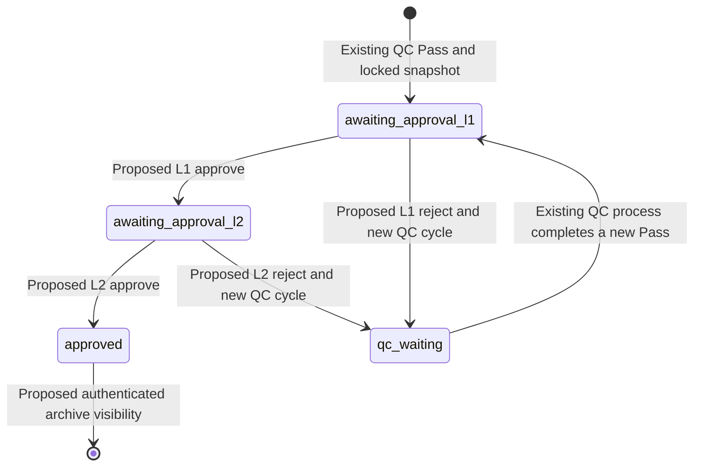
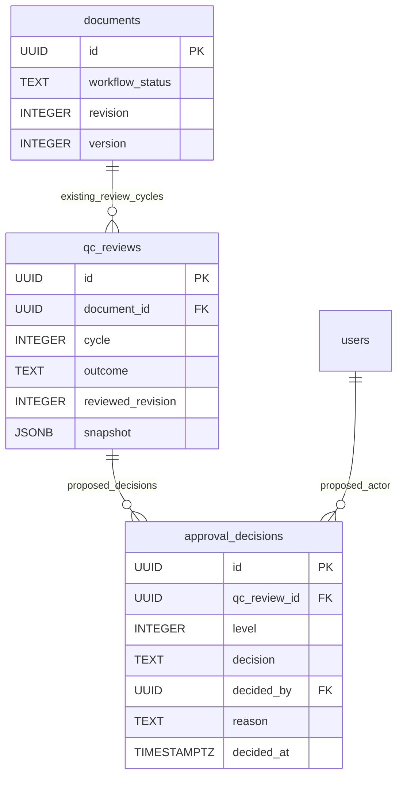

# Approval Levels 1 and 2, and basic archive viewer

**Planning handoff: 2026-11-14. Nothing in this document is an implemented approval/archive feature.** The current runtime stops at `awaiting_approval_l1`. Proposed names and business rules below require confirmation before implementation.

## 1. Is the remaining work simpler?

Yes, if it stays limited to two human decision gates and authenticated read-only viewing. Capture, OCR, metadata verification, image history, authentication, audit, pagination and preview components already exist. Approval should not scan, re-run OCR, rewrite metadata or create another document copy.

The nontrivial work is correctness: decisions must identify the exact QC-passed revision, L2 must follow L1, rejection must invalidate the old approval path, and unauthorized users must not fetch images/text directly. UI reuse makes the screens smaller; it does not replace those checks. Earlier UI refinements also remain runtime-unverified and will need separately authorized regression work.

## 2. Existing foundation versus missing work

| Already implemented                                                       | Still required                                                                   |
| ------------------------------------------------------------------------- | -------------------------------------------------------------------------------- |
| `approver_l1`, `approver_l2`, `archive_viewer` roles and permission codes | Working queues, detail routes and role-scoped read APIs                          |
| Role-combination restrictions                                             | Per-document historical independence checks, even after role changes             |
| QC-passed snapshot with page/metadata/OCR/correction identities           | Approval decisions bound to that snapshot and revision                           |
| `awaiting_approval_l1` and current edit locks                             | L2/final states, extended database/API locks and rejection transitions           |
| Version-checked mutations and append-only audit/history patterns          | Atomic approve/reject operations, duplicate/race protection and approval history |
| `WorklistTable`, `PageViewer`, `IconButton`, shell and URL-state hook     | Read-only approval/viewer composition and backend access rules                   |

Do not grant approval/viewer roles broad `qc:read`, operator ownership or OCR-management permissions just to reuse a screen. Reuse the presentation, not the privilege.

## 3. Recommended minimal behavior — proposed

1. **L1 queue:** list QC-passed documents awaiting L1. Read metadata, included pages, effective OCR, QC exceptions/findings and decision history from the saved QC revision. Approve to L2 or reject with a reason.
2. **L2 queue:** expose only revisions approved at L1. A different eligible officer approves or rejects that same revision.
3. **Final archive:** L2 approval makes the revision visible to authorized archive viewers. Use a paginated list and a read-only document/page view. Basic title/number/type filters may reuse SQL; no semantic/full-text search infrastructure is needed for this scope.
4. **Rejection:** recommended default is return to QC in a new review cycle, with the rejection reason visible. QC can correct within its existing authority or return to the operator for capture rework. Prior snapshots/approval decisions stay historical; a new QC Pass requires fresh L1 and L2 decisions.
5. **No separate publication step by default:** use final approval as the authenticated archive-visibility gate. Add publication as a separate workflow only if explicitly required.

Approval detail is read-only except decision/note controls. No rotation, exclusion, reorder, correction, metadata edit, scan or reprocess action belongs there. Do not add approval claims/leases unless exclusive assignment is a confirmed business need; transactional version checks and one terminal decision per level/review can handle the initial small workflow.

### Proposed state extension

Only `awaiting_approval_l1` and `qc_waiting` below exist today. `awaiting_approval_l2` and `approved` are proposed new states, not accepted by migration 010's current CHECK constraint.

The `qc_waiting` → L1 arrow abbreviates claim/review/pass, not a bypass. Capture remains completed on an approval rejection to QC; only a later explicit QC return would pause/reopen the batch. No post-approval unlock, withdrawal or final-rejection state is proposed for the basic version.

## 4. Minimal persistence proposal

Add one append-only approval-decision table in a **new** migration. Reuse existing documents, QC reviews, image history and audit logs; do not copy all pages/OCR into new approval tables.

**Proposed constraints:** level 1/2; decision approved/rejected; unique `(qc_review_id,level)`; nonempty rejection reason; append-only decision records. Only a QC review with `outcome='passed'` is eligible. L2 requires L1 approval for that exact review. The QC review supplies document/reviewed-revision identity without a redundant independently mutable document copy.

Schema FKs alone do not enforce these cross-row workflow rules: implement them transactionally. A new review cycle is the way to obtain fresh decisions after rejection, not an UPDATE to an old decision. Final archive eligibility must match current document state/cycle and the exact L2-approved QC snapshot, not any old approved row.

An explicit approved-review pointer or extra assignment table should be added only if the implementation needs it for a confirmed access/query requirement. Exact table/state/route names are design proposals, not a frozen migration contract.

## 5. Required transition guards

Every approve/reject operation should:

1. Authenticate, validate CSRF/input and require the level-specific permission.
2. Lock batch → document → relevant QC review using the existing lock order; compare the document version supplied by the browser.
3. Check the expected workflow state, passed QC review, current cycle and unchanged reviewed content revision. Reject duplicate, stale and out-of-order decisions.
4. Check historical participation: neither approval level should act on personally captured/created or QC-reviewed work; L2 must also be a different actor from L1. Role changes must not provide a bypass. The complete independence policy still needs confirmation below.
5. Insert the approval decision, update state/version and append a bounded audit event in the same transaction. A failed transaction must leave no partial decision/state change.
6. On rejection, retain the previous snapshot/decisions and create the agreed new QC cycle atomically. Old approvals cannot carry forward to a revised document.

Re-reading/viewing is not an approval, and network retries must not record a second decision. With unique constraints and version checks, duplicate requests can return an explicit already-decided/conflict response without inventing another queue service.

### Critical lock migration checklist

Current protection names `awaiting_approval_l1` explicitly in several places. Adding a status value alone can accidentally unlock content. Review at least:

- `migrations/010_quality_control.sql`: document status CHECK, `protect_qc_revision` and the `queue_batch_ocr` wrapper. Extend protections in a **new migration**, never edit 010/011.
- `server/workflow.mjs`: operator-edit allowlists and version/review guards.
- `server/qc.mjs`: metadata policy/edit decisions, claim eligibility, readiness refresh and queue filters/counters.
- `server/ocr.mjs` and `server/document-metadata.mjs`: enqueue/reprocess/correction/history behavior and current-versus-historical access.
- `server/batches.mjs`, authenticated page/image routes and `server/capture-storage.mjs`: rework/replacement access and safe resolution of saved image identities.
- `server/auth.mjs`, `server/enterprise.mjs`, `src/routes.js`, `src/main.jsx`: backend permissions, actual endpoints and role-aware navigation.
- Approval/viewer tests and schema fixtures; old history must remain readable while new mutations remain locked.

Locked QC snapshots currently omit raw storage paths. Reconstruct historical image access from retained page/revision/checksum identities on the server; do not expose storage keys or blindly serve the mutable latest image. Effective text must use the snapshot's result/correction IDs, including exact-result reuse references.

## 6. Decisions to confirm before coding

| Question                                            | Smallest recommended default                                                                    |
| --------------------------------------------------- | ----------------------------------------------------------------------------------------------- |
| Where do L1/L2 rejections go?                       | Back to QC in a new cycle; QC may return to the operator if needed                              |
| Must approval work be exclusively claimed/assigned? | No new lease system initially; versioned atomic decisions                                       |
| Which documents may an approver read?               | Pending work for that level and explicitly permitted history; no broad capture/QC grant         |
| Independence after role changes?                    | Disallow decisions on personally captured/QC-reviewed documents and the same actor across L1/L2 |
| What can an Archive Viewer see?                     | Only current final-approved revisions, never pending/rejected/soft-deleted work                 |
| Is final approval also archive visibility?          | Yes, authenticated visibility only; no public publication step                                  |
| Is original PNG download permitted?                 | Confirm explicitly; preview permission must not automatically imply export permission           |
| Are PDF, bulk export or advanced search required?   | No for the basic version; separately scope them later                                           |

No business answer above is silently implemented by this documentation task.

## 7. Build order and acceptance handoff

1. Confirm the decisions above and add a forward migration for states, decisions and all lock protections.
2. Implement level-scoped read APIs and atomic approval/rejection; reject direct unauthorized image/text requests.
3. Reuse `WorklistTable` for L1/L2 queues and `PageViewer`/read-only metadata/history for details. Persist navigational state in URLs without draft/private text.
4. Add the archive list/detail using the final-approved snapshot as its source of truth; keep export disabled until agreed.
5. Obtain explicit user approval before running verification. Planned coverage: normal QC → L1 → L2 → viewer, both rejection paths, re-QC invalidation, stale/duplicate/racing decisions, role changes, direct file access denial, preserved locks, URL restoration and existing operator/QC regressions.

No new OCR, browser or physical verification is authorized here. No new recognition engine, PDF generation, embeddings, multi-document splitting, notifications, public links or deployment topology is required for this minimal completion path.
