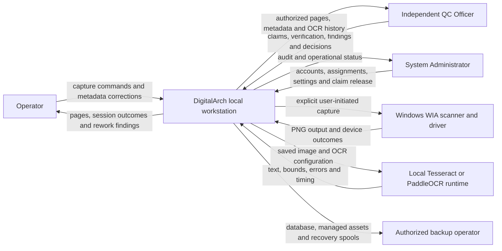
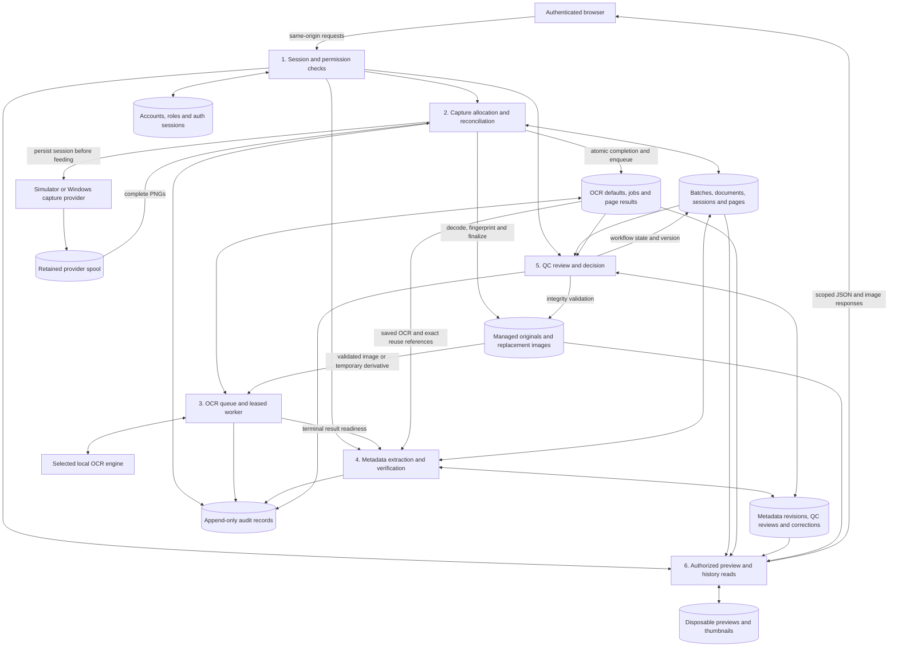
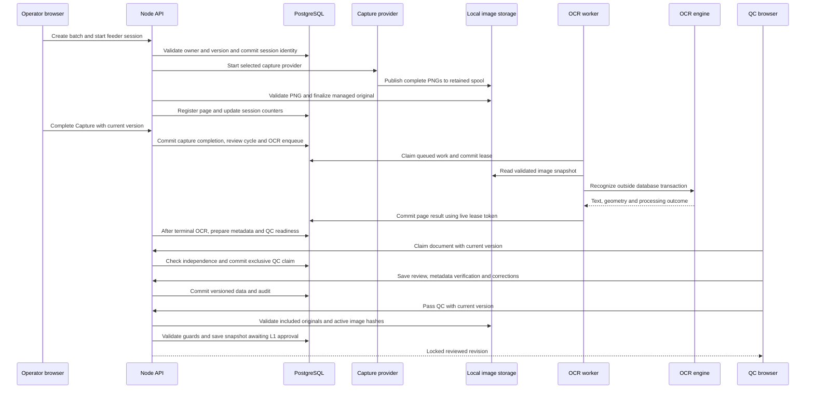

# Data flow diagrams

**As-built baseline: 2026-11-14.** These Mermaid diagrams describe implemented capture/OCR/QC flows. They are source-derived documentation, not evidence that a new scan or inference was run. [APPROVAL.md](APPROVAL.md) contains the separate planned extension.

## 1. System context

Administrator is oversight, not inherited capture/QC/approval authority. Approval and Archive Viewer roles are not drawn as live flows because their screens/APIs are not implemented. Backups are an operational responsibility, not a built-in automated backup service.

## 2. Processes and stores

All database stores below are logical groups in the **same PostgreSQL database**, not separate services. Files remain local and authenticated access passes through Node.

### Data handling rules

- Persist batch/document/session identity before acquisition. Reconciliation registers valid PNGs idempotently; a failed transaction does not discard its spool or managed original.
- Original checksums and capture provenance are immutable. Replacements switch the active reference only after confirmation; old/candidate images remain retained.
- OCR reads the effective image snapshot, not an unversioned arbitrary upload. Temporary preparation never overwrites originals. Result commits are fenced by the job lease and retain engine/configuration identity.
- Extraction combines available current OCR/corrections into candidates. Human metadata remains authoritative; historical per-run metadata is read-only.
- QC reads and changes the same logical document. Return changes workflow/ownership of work, not file identity. Pass freezes a reviewed snapshot and rejects outstanding OCR.
- Audit events are intentionally bounded, but can contain user-entered reasons/notes and identifiers. Treat the audit store as private; do not export it publicly or use it to duplicate document text/secrets.
- Preview derivatives are caches, not source records or backups. The browser never receives raw filesystem paths or database credentials.

## 3. Capture to QC sequence

The sequence abbreviates multi-page commits, polling, retries and return/resubmission; it does not imply one transaction spans scanning or OCR. Original capture and replacement files remain available after review decisions.

## 4. Trust and privacy boundaries

| Boundary                         | Enforcement / limit                                                                                      |
| -------------------------------- | -------------------------------------------------------------------------------------------------------- |
| Browser → API                    | Session cookie, same-origin checks, CSRF on mutations, body validation and server-side permission checks |
| Role → document                  | Assigned-operator checks or explicit QC/oversight permissions; no access inferred from a URL             |
| Capture spool → managed original | Decode, size/pixel limits, checksum, safe paths and exclusive finalization                               |
| Worker → database                | Persistent job lease/token, expiry, image/config identity and versioned results                          |
| QC → decision                    | Live independent claim, version checks, checklist/findings/metadata/OCR/file gates                       |
| Database → image read            | Scoped endpoints; private files are not a publicly served scan directory                                 |
| Workstation → backup             | Preserve database and managed/spool relationships together; no automated restore drill claimed           |

Queue search terms can be present in navigation URLs/history. Private document content, OCR excerpts, account credentials and raw evidence must not be copied into public docs, fixtures or issue logs. Local HTTP/loopback and privileged administrator tamper risks remain; this is not a hardened remote deployment.
