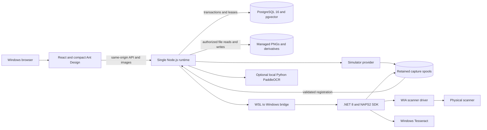
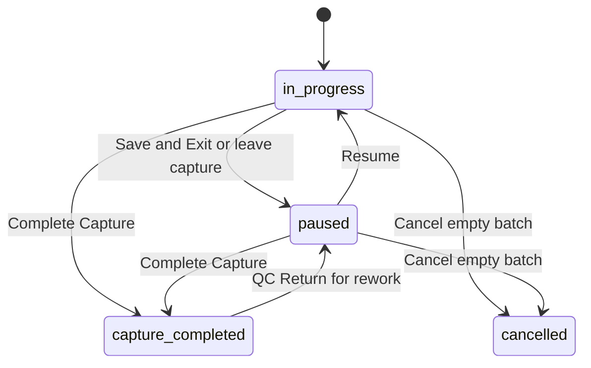
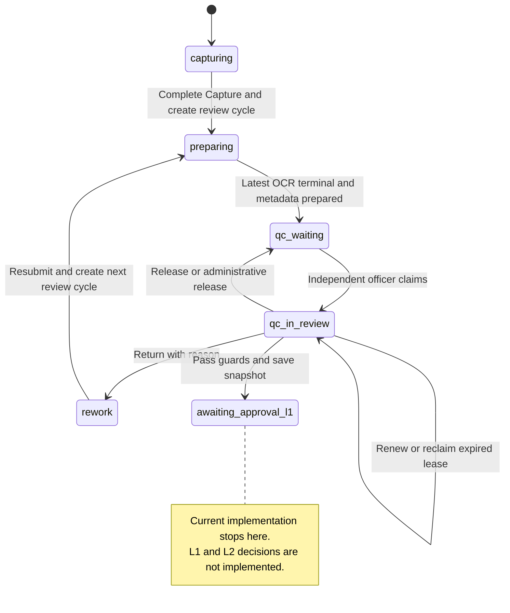

# Design and development document

**Baseline: 2026-11-14.** This is the as-built technical handoff for the local source through capture, OCR, metadata, QC and rework. “DND” here means design and development. [DESIGN.md](DESIGN.md) owns visual rules; [APPROVAL.md](APPROVAL.md) describes proposed, unimplemented L1/L2/viewer work.

## 1. Delivery boundary

| Area                        | Current implementation                                                                                            |
| --------------------------- | ----------------------------------------------------------------------------------------------------------------- |
| Accounts and administration | Six roles, explicit permissions, sessions/CSRF, account lifecycle, audit and settings                             |
| Capture                     | Simulator and Windows WIA/NAPS2, multi-session batches, safe pause/resume/recovery                                |
| OCR                         | Persistent PostgreSQL queue, Tesseract and optional PaddleOCR, retained results, global defaults                  |
| Metadata and QC             | Current document metadata, provenance/verification, exclusive claims, findings, corrections and same-batch rework |
| Shared UI                   | Compact worklists, bounded document inspection and URL-backed QC/operator list state                              |
| Handoff                     | QC Pass locks a reviewed snapshot at `awaiting_approval_l1`                                                       |
| Still planned               | Approval Level 1, Approval Level 2 and an authenticated read-only archive viewer                                  |

Implemented in source does not mean freshly runtime-verified. Earlier Phase 4 test evidence predates the latest queue/shared-component/URL refinements. Those refinements received formatting and static checks only; see [ENGINEERING_REPORT.md](ENGINEERING_REPORT.md).

## 2. Architecture and deployment

React/Vite and the backend run in WSL2 for the supported development setup. The browser, WIA driver and Windows helpers run on Windows. PostgreSQL uses the existing local Docker image with pulls disabled. Production serves the built frontend from Node; development uses the origin-preserving proxy. There is no Redis, separate OCR service, cloud storage or second workflow database. pgvector is installed but embeddings are not implemented.

One runtime holds a database/schema advisory lock; a second runtime cannot begin capture/recovery. Physical capture is globally serialized. OCR page concurrency is fixed at one; supported Paddle thread budgets are not page concurrency.

## 3. Source ownership

| Responsibility                                         | Source                                                                                         |
| ------------------------------------------------------ | ---------------------------------------------------------------------------------------------- |
| HTTP, security headers and frontend fallback           | `server/http.mjs`, `server.mjs`                                                                |
| Authenticated API dispatch and runtime recovery        | `server/enterprise.mjs`                                                                        |
| Database pool, transactions, migrations                | `server/db.mjs`, `migrations/`                                                                 |
| Authentication, permissions, users and role separation | `server/auth.mjs`                                                                              |
| Capture/session/rework orchestration                   | `server/batches.mjs`, `bridge.mjs`, `DigitalArch.Service/`                                     |
| Original validation, revisions and derivatives         | `server/capture-storage.mjs`, `server/storage.mjs`                                             |
| OCR queue, leases, adapters and settings               | `server/ocr.mjs`, `server/ocr-provider.mjs`, `server/ocr-engines.mjs`, `server/ocr-paddle.mjs` |
| Rules and current/historical metadata                  | `server/metadata-extract.mjs`, `server/qc-metadata.mjs`, `server/document-metadata.mjs`        |
| Document edit/claim/version guards                     | `server/workflow.mjs`                                                                          |
| QC queue, review, decisions and readiness              | `server/qc.mjs`                                                                                |
| Navigation and URL state                               | `src/main.jsx`, `src/routes.js`, `src/useUrlState.js`                                          |
| Shared worklists                                       | `src/WorklistTable.jsx`, `src/BatchList.jsx`, `src/style.css`                                  |
| Shared document inspection                             | `src/QcWorkspace.jsx`, `src/PageViewer.jsx`, `src/MetadataPanel.jsx`                           |

## 4. Three independent state models

### Capture state: `archive_batches.status`

Soft deletion is a tombstone, not another capture status. Completion still has validation/version/session guards. Return reopens the **same** batch; it does not create another document.

### Document workflow: `documents.workflow_status`

Lease expiry alone does not change `qc_in_review` to `qc_waiting`: the waiting queue includes expired reviews and permits a version-checked reclaim. A cancelled/failed terminal OCR job can make a document ready for human QC, but does not automatically satisfy QC Pass.

### OCR state: `ocr_jobs.status` and batch OCR summary

Jobs use `queued`, `running`, `paused`, `completed`, `completed_with_errors`, `failed` and `cancelled`. Per-page results use `processing` while working and have their own attempts/stale generation. OCR state is not capture completion, QC approval or archive visibility. Detailed transitions and operational limits remain in [OCR.md](OCR.md).

## 5. Identity, versions and persistence

- Routes such as `/documents/:batchId` and `/api/qc/:batchId` take the **batch UUID**, not `documents.id`. A generated `batch_code` is a display/copy identifier, never the authorization boundary.
- Batch mutations compare `archive_batches.version`; document QC mutations compare `documents.version`; metadata saves compare `documents.metadata_version`. These numbers are not interchangeable.
- `documents.revision` identifies reviewed content. `pages.image_revision` identifies an effective page-image generation. `qc_reviews.cycle` identifies a review attempt. A new cycle does not delete older findings/decisions.
- Current metadata lives on `documents.metadata_json`; per-run `document_metadata` remains read-only history. Human OCR corrections append separately from machine results.
- Capture/order/source originals are immutable. Logical display order, rotation, exclusion and confirmed replacement references are separate. See [ERD.md](ERD.md) for physical relationships and JSON-reference limitations.

## 6. Mutation and concurrency contract

1. Authenticate the session; reject disabled/expired/revoked accounts and incomplete password onboarding.
2. Validate origin/CSRF for mutations, then permission, identifiers, body keys and value limits.
3. Lock the batch, document and applicable review in the established order; compare the supplied version.
4. Enforce ownership, allowed state, no active capture/reconciliation/replacement and a live independent QC claim where required.
5. Commit state/version/history/audit changes atomically. File output surviving a failed transaction is retained for reconciliation, not deleted as rollback.

Capture commits session identity before feeding. OCR claims/commits a lease before recognition and checks its token when committing results. Recognition does not hold the database transaction open. QC Pass validates included original/active files, checks pending OCR/checklist/metadata/findings, records a snapshot and locks the document.

Expected failures are actionable: stale version or lost claim requires reload/reclaim; permission denial must not be bypassed through a hidden button. PostgreSQL failure never switches persistence to JSON. Backups must include database, image revisions and capture spools together.

## 7. Current API map

This is a route-family index, not a new API or a promise that every role can read every family. `server/enterprise.mjs` and service-level checks are authoritative.

| Family                                                                     | Contract                                                                                                                            |
| -------------------------------------------------------------------------- | ----------------------------------------------------------------------------------------------------------------------------------- |
| `/api/auth/login`, `/me`, `/logout`, `/change-password`                    | Session bootstrap, rotation and onboarding                                                                                          |
| `/api/batches`                                                             | Create or list authorized batches; list returns `batches`, filtered `total/pages/sessions`, recent actor activity                   |
| `/api/batches/:batchId` and action suffixes                                | Capture detail, pause/resume/completion, session allocation, resubmission, replacement/reorder and soft deletion                    |
| `/api/batches/:batchId/metadata`                                           | GET current metadata; PATCH fields with metadata `version`; POST `/extract` refreshes candidates                                    |
| `/api/qc/queue`                                                            | Queue results with filtered `total/pages/sessions` and separate queue-wide `counts`                                                 |
| `/api/qc/:batchId`                                                         | Document, pages, sessions, current metadata, review cycles, findings and activity                                                   |
| `/api/qc/:batchId/:action`                                                 | Claim/release/heartbeat/save/pass/return/findings/page review/edit/text correction/policy/reprocessing; document `version` required |
| `/api/qc/:batchId/pages/:pageId`                                           | Current page OCR/correction information and image revision history                                                                  |
| `/api/qc/:batchId/pages/:pageId/revisions/:revisionId/image` or `/preview` | Authorized historical image access                                                                                                  |
| `/api/ocr/jobs` and job/page routes                                        | OCR jobs, controls, results and images; old run metadata GET only                                                                   |
| `/api/settings/ocr`                                                        | Administrator defaults with optimistic version checks                                                                               |
| `/api/admin/*`                                                             | Users, roles, reassignment, audit and sanitized system information                                                                  |

QC list parameters are `filter`, `search`, `metadata`, `ocr`, `sort`, `direction`, `limit` and `offset`. Batch lists use `status`, `search`, `sort`, `direction`, `limit` and `offset`. Sort identifiers are mapped through SQL allowlists; input is never interpolated as an arbitrary column. Current list limits are at most 100 and offsets at most 1,000,000. OCR APIs and settings are detailed in [OCR.md](OCR.md).

No approval/archive API is implemented, and archive-role permission names do not grant access to the current operator/QC image routes.

## 8. Shared UI contract

`WorklistTable` is used by QC, Capture Workspace/My Batches and administrator batch assignments. It accepts ordinary Ant Design Table props plus:

| Prop         | Meaning                                                                                         |
| ------------ | ----------------------------------------------------------------------------------------------- |
| `totals`     | Array of `{ label, value, icon }` for the filtered result, supplied by the caller               |
| `pagination` | Controlled Ant Design pagination props, including `current`, `pageSize`, `total` and `onChange` |
| `scroll`     | Horizontal table configuration; the component measures and owns its vertical scroll area        |

`ColumnHeading`, `BatchIdentity` and `BatchIdHeading` share heading/copy behavior. `BatchIdentity` can show caller-provided text or only its info/copy icon. The shared component must not fetch data, grant permissions or invent approval actions. Callers own query state, columns, version checks and confirmations.

Future role queues should reuse that table, `PageViewer`, `IconButton`, the compact theme and the existing shell. Read-only viewing must be a real permission mode, not an editable QC screen with buttons merely hidden. Existing OCR/admin tables have not all been migrated to `WorklistTable`; the shared height hook is reused there.

### URL-backed state currently implemented

| Surface                    | Query keys                                                                                                                                                               |
| -------------------------- | ------------------------------------------------------------------------------------------------------------------------------------------------------------------------ |
| QC queue                   | `tab`, `status`, `q`, `metadata`, `ocr`, `sort`, `direction`, `page`, `size`                                                                                             |
| Operator/admin batch lists | `status`, `q`, `sort`, `direction`, `page`, `size`, `activity`                                                                                                           |
| Document inspection        | `tab`, `page`, `rail`, `session`, `excluded`, `original`, `revision`, `zoom`, `pixels`, `fullscreen`, `processing`, `machine`, `policy`, `evidence`, `field`, `returnTo` |

In document URLs, `page` is a UUID and `rail` is the thumbnail-window number. In list URLs, `page` is a one-based page number. Boolean options use `1`/`0`; zoom uses `width`, `page` or a bounded numeric scale. Supported list sizes are 25/50/100. Invalid choices fall back to safe supported values.

Explicit navigation pushes browser history; typing and transient preview/disclosure changes replace the entry. `digitalarch:url-state` synchronizes the hook with the existing guarded route navigation. `returnTo` restores a supported originating list. No new router or localStorage authentication was added.

This is **not** a claim that every OCR/admin/scanner control is URL-backed. Draft forms, finding/decision text, passwords and document/OCR contents are never serialized. Queue search terms do enter the URL/history: avoid sensitive searches in shared links. URL state is navigation, not authorization.

## 9. Remaining development path

Implement approval/viewer as a small extension to the same database and revision history, not another capture/OCR lifecycle. Before adding states, extend every current `awaiting_approval_l1` lock/guard and add rejection invalidation. The proposed sequence, unresolved business rules and acceptance checklist are in [APPROVAL.md](APPROVAL.md).

No deployment hardening, new OCR engine, PDF pipeline, AI search, bulk export or multi-document splitting is implied by that plan. Agent test/browser/OCR/hardware runs still require the permissions documented in [AGENTS.md](AGENTS.md).
