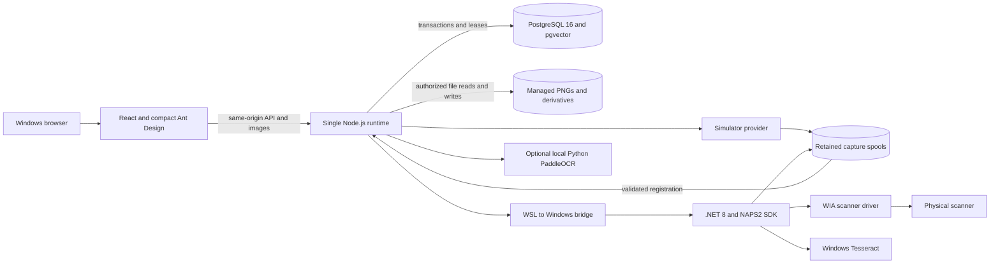
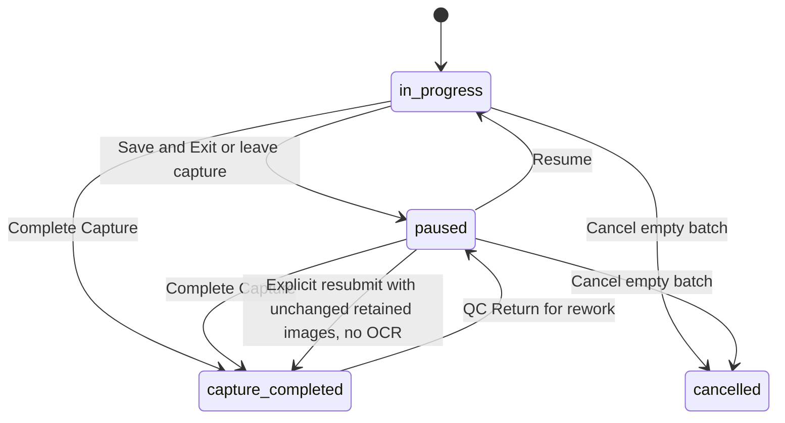
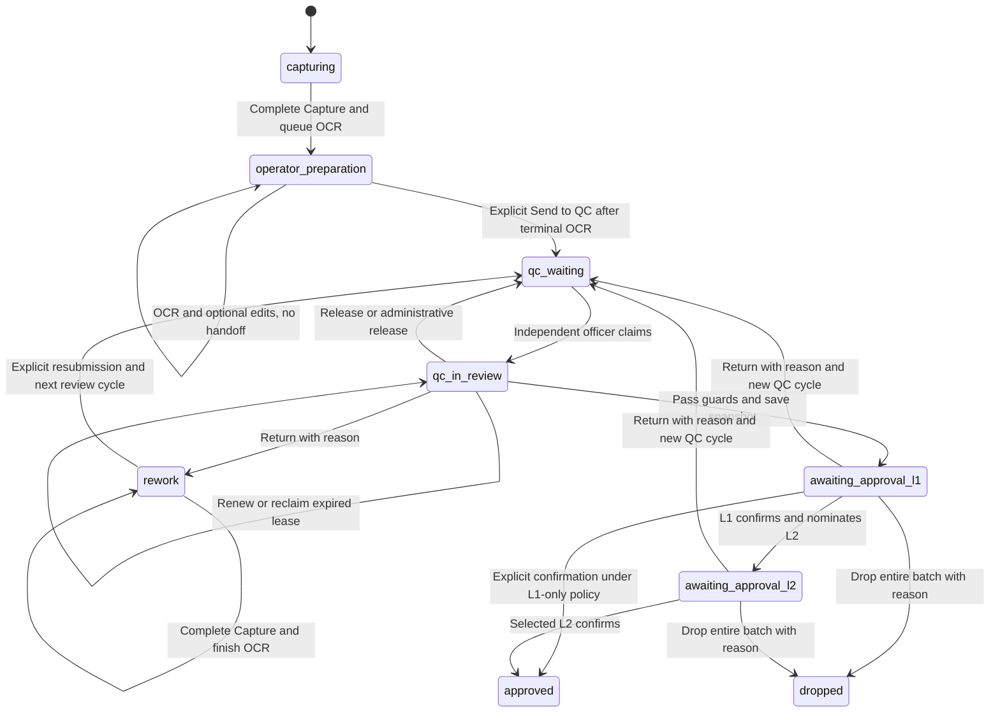

# Design and development document

**Source baseline: 2026-11-15.** This handoff covers capture, OCR, metadata, QC/rework, configurable L1/L2 approval and staff Documents. “DND” means design and development. [DESIGN.md](DESIGN.md) owns visual rules; [APPROVAL.md](APPROVAL.md) defines decisions/QR receipts and [VIEWER.md](VIEWER.md) defines the separate approved-viewer library, PDF transfers and audit tables.

**2026-11-15 extension:** migrations 012–013 add automatic included-page numbering and editable page labels, with batch-scoped numbering queries; details and permission boundaries are in [QC.md](QC.md#page-names-and-numbering). These follow-up changes remain runtime-unverified.

## 1. Delivery boundary

| Area                        | Current implementation                                                                                            |
| --------------------------- | ----------------------------------------------------------------------------------------------------------------- |
| Accounts and administration | Six roles, explicit permissions, sessions/CSRF, account lifecycle, audit and settings                             |
| Capture                     | Simulator and Windows WIA/NAPS2, multi-session batches, safe pause/resume/recovery                                |
| OCR                         | Persistent PostgreSQL queue, Tesseract and optional PaddleOCR, retained results, global defaults                  |
| Metadata and QC             | Current document metadata, provenance/verification, exclusive claims, findings, corrections and same-batch rework |
| Shared UI                   | Compact worklists, bounded document inspection and URL-backed QC/operator list state                              |
| Approval and Documents      | Fixed first-pass policy, L1/selected-L2 confirmation, QC returns, batch drops, scoped registry and QR receipts    |
| Viewer library              | Administrator-approved registration, published metadata/images, list/grid/tabs and audited image-only PDFs        |
| Staff notifications         | Top-navbar read/unread/view inbox, transactional PostgreSQL events/recipients and LISTEN-NOTIFY/SSE updates       |

Implemented in source does not mean freshly runtime-verified. Earlier Phase 4 test evidence predates the latest queue/shared-component/URL refinements. Those refinements received formatting and static checks only; see [ENGINEERING_REPORT.md](ENGINEERING_REPORT.md).

## 2. Architecture and deployment

React/Vite and the backend run in WSL2 for the supported development setup. The browser, WIA driver and Windows helpers run on Windows. PostgreSQL uses the existing local Docker image with pulls disabled. Production serves the built frontend from Node; development uses the origin-preserving proxy. There is no Redis, separate OCR service, cloud storage or second workflow database. pgvector is installed but embeddings are not implemented.

One runtime holds a database/schema advisory lock; a second runtime cannot begin capture/recovery. Physical capture is globally serialized. OCR page concurrency is fixed at one; supported Paddle thread budgets are not page concurrency.

## 3. Source ownership

| Responsibility                                         | Source                                                                                             |
| ------------------------------------------------------ | -------------------------------------------------------------------------------------------------- |
| HTTP, security headers and frontend fallback           | `server/http.mjs`, `server.mjs`                                                                    |
| Authenticated API dispatch and runtime recovery        | `server/enterprise.mjs`                                                                            |
| Database pool, transactions, migrations                | `server/db.mjs`, `migrations/`                                                                     |
| Authentication, permissions, users and role separation | `server/auth.mjs`                                                                                  |
| Capture/session/rework orchestration                   | `server/batches.mjs`, `bridge.mjs`, `DigitalArch.Service/`                                         |
| Original validation, revisions and derivatives         | `server/capture-storage.mjs`, `server/storage.mjs`                                                 |
| OCR queue, leases, adapters and settings               | `server/ocr.mjs`, `server/ocr-provider.mjs`, `server/ocr-engines.mjs`, `server/ocr-paddle.mjs`     |
| Rules and current/historical metadata                  | `server/metadata-extract.mjs`, `server/qc-metadata.mjs`, `server/document-metadata.mjs`            |
| Document edit/claim/version guards                     | `server/workflow.mjs`                                                                              |
| QC queue, review, decisions and readiness              | `server/qc.mjs`                                                                                    |
| Staff notification delivery/read state                 | `migrations/019_staff_notifications.sql`, `server/notifications.mjs`, `src/StaffNotifications.jsx` |
| Navigation and URL state                               | `src/main.jsx`, `src/routes.js`, `src/useUrlState.js`                                              |
| Shared worklists                                       | `src/WorklistTable.jsx`, `src/BatchList.jsx`, `src/style.css`                                      |
| Shared document inspection                             | `src/QcWorkspace.jsx`, `src/PageViewer.jsx`, `src/MetadataPanel.jsx`                               |

## 4. Three independent state models

### Capture state: `archive_batches.status`

Soft deletion is a tombstone, not another capture status. Completion still has validation/version/session guards. Return reopens the **same** batch; it does not create another document.

### Document workflow: `documents.workflow_status`

Lease expiry alone does not change `qc_in_review` to `qc_waiting`: the waiting queue includes expired reviews and permits a version-checked reclaim. Terminal failed/cancelled OCR permits explicit submission with warnings, not automatic handoff or QC Pass. The legacy `preparing` state remains supported only for already-submitted pre-014 work.

### OCR state: `ocr_jobs.status` and batch OCR summary

Jobs use `queued`, `running`, `paused`, `completed`, `completed_with_errors`, `failed` and `cancelled`. Per-page results use `processing` while working and have their own attempts/stale generation. OCR state is not capture completion, QC approval or archive visibility. Detailed transitions and operational limits remain in [OCR.md](OCR.md).

## 5. Identity, versions and persistence

- Routes such as `/documents/:batchId` and `/api/qc/:batchId` take the **batch UUID**, not `documents.id`. A generated `batch_code` is a display/copy identifier, never the authorization boundary.
- Batch mutations compare `archive_batches.version`; document QC mutations compare `documents.version`; metadata saves compare `documents.metadata_version`. These numbers are not interchangeable.
- `documents.revision` identifies reviewed content. `pages.image_revision` identifies an effective page-image generation. `qc_reviews.cycle` identifies a review attempt. A new cycle does not delete older findings/decisions.
- Current metadata lives on `documents.metadata_json`; per-run `document_metadata` remains read-only history. Human OCR corrections append separately from machine results.
- Capture/order/source originals are immutable. Logical display order, rotation, exclusion and confirmed replacement references are separate. See [ERD.md](ERD.md) for physical relationships and JSON-reference limitations.
- `document_pages.page_number` is a derived contiguous included-document position, not stored `pages.display_order` or immutable `capture_order`. Optional `pages.page_label` overrides the default Page N name without changing any identity, order or file. Capture/QC/metadata evidence use the same projection; OCR history retains capture-order pagination while displaying current names. New QC snapshots retain the labels/numbers as reviewed.

## 6. Mutation and concurrency contract

1. Authenticate the session; reject disabled/expired/revoked accounts and incomplete password onboarding.
2. Validate origin/CSRF for mutations, then permission, identifiers, body keys and value limits.
3. Lock the batch, document and applicable review in the established order; compare the supplied version.
4. Enforce ownership, allowed state, no active capture/reconciliation/replacement and a live independent QC claim where required.
5. Commit state/version/history/audit changes atomically. File output surviving a failed transaction is retained for reconciliation, not deleted as rollback.

Capture commits session identity before feeding. OCR claims/commits a lease before recognition and checks its token when committing results. Recognition does not hold the database transaction open. QC Pass validates included original/active files, checks pending OCR/checklist/metadata/findings, records a snapshot and locks the document.

Expected failures are actionable: stale version or lost claim requires reload/reclaim; permission denial must not be bypassed through a hidden button. PostgreSQL failure never switches persistence to JSON. Backups must include database, image revisions and capture spools together.

## 7. Current API map

This is a route-family index, not a new API or a promise that every role can read every family. `server/enterprise.mjs` and service-level checks are authoritative.

| Family                                                                     | Contract                                                                                                                                                                                        |
| -------------------------------------------------------------------------- | ----------------------------------------------------------------------------------------------------------------------------------------------------------------------------------------------- |
| `/api/auth/login`, `/me`, `/logout`, `/change-password`                    | Session bootstrap, rotation and onboarding                                                                                                                                                      |
| `/api/batches`                                                             | Create or list authorized batches; list returns `batches`, filtered `total/pages/sessions`, access-scoped per-view `counts`, compatible `returned` count and recent actor activity              |
| `/api/batches/:batchId` and action suffixes                                | Capture detail, pause/resume/completion, session allocation, resubmission, replacement/reorder and soft deletion                                                                                |
| `/api/batches/:batchId/cancel-scan`                                        | POST `{sessionId}` cancels only the assigned capture creator's exact session; no live page-count/batch-version race. Completed pages remain, and reconciliation records an interrupted session. |
| `/api/scanner/status`                                                      | Includes caller-scoped running capture identity, saved-page count and cancellation/process state so reloads and other tabs restore the Cancel-only lock.                                        |
| `/api/batches/:batchId/submit-qc` and `/resubmit-qc`                       | Explicit owner handoff after completed capture and terminal OCR; batch `version` required, metadata optional, sender/time audited                                                               |
| `/api/batches/:batchId/metadata`                                           | GET current metadata; PATCH fields with metadata `version`; POST `/extract` refreshes candidates                                                                                                |
| `/api/qc/queue`                                                            | Queue results with filtered `total/pages/sessions` and separate queue-wide `counts`                                                                                                             |
| `/api/qc/:batchId`                                                         | Document, pages, sessions, current metadata, review cycles, findings and activity                                                                                                               |
| `/api/qc/:batchId/:action`                                                 | Claim/release/heartbeat/save/pass/return/findings/page review/edit/text correction/policy/reprocessing; document `version` required                                                             |
| `/api/qc/:batchId/pages/:pageId`                                           | Current page OCR/correction information and image revision history                                                                                                                              |
| `/api/qc/:batchId/pages/:pageId/revisions/:revisionId/image` or `/preview` | Authorized historical image access                                                                                                                                                              |
| `/api/ocr/jobs` and job/page routes                                        | OCR jobs, controls, results and images; old run metadata GET only                                                                                                                               |
| `/api/settings/ocr`                                                        | Administrator defaults with optimistic version checks                                                                                                                                           |
| `/api/admin/*`                                                             | Users, roles, reassignment, audit and sanitized system information                                                                                                                              |

QC list parameters are `filter`, `search`, `metadata`, `ocr`, `sort`, `direction`, `limit` and `offset`. Batch lists use `status`, `search`, `sort`, `direction`, `limit` and `offset`. Sort identifiers are mapped through SQL allowlists; input is never interpolated as an arbitrary column. Current list limits are at most 100 and offsets at most 1,000,000. OCR APIs and settings are detailed in [OCR.md](OCR.md).

Batch-list `status` selects work/tracking views without changing `archive_batches.status`:

- `in_progress` / `paused`: underlying capture status, excluding document rework.
- `capture_completed`: completed capture without a submitted current review cycle, excluding rework/final approval.
- `rework`: current document rework; returns current-cycle `qc_return_reason` / `qc_returned_at` and defaults to `sort=returned_at&direction=desc`.
- `submitted`: completed capture with current-cycle `qc_reviews.submitted_at`, excluding rework/final approval. Submission records actor/time independently of claims. Claim release/expiry does not undo handoff; rework always requires explicit resubmission, but metadata/ordering/labels/exclusions reuse unchanged retained images and OCR without another completion step. New/changed scans still require completion/OCR.
- `completed`: document workflow `approved`, never merely `awaiting_approval_l1`; explicit final confirmation now populates this view.

Rows expose `workflow_status`, the current review's `qc_reviewer` and `qc_claim_live`. `sort=workflow_status` orders the stage column; an expired claim is not labelled as active QC. Filtered totals and independent per-view badge `counts` use the same predicates and authorized nondeleted scope in a read-only snapshot. `returned` remains an alias of `counts.rework`. Unfiltered status and the existing cancelled filter retain their API behavior. Ordinary operators see only current assignments; oversight remains permission-scoped. Resuming rework preserves its return date; resubmission removes current return indicators and returns it to tracking. Capture status, actor history, QC snapshots and mutation permissions are unchanged.

`server/approvals.mjs` supplies policy settings, scoped `/api/records` content/decisions and `/api/confirmations/:id` receipts/QR. Staff notifications now use the shared navbar inbox, transactional audit-event triggers, per-recipient read/view state and PostgreSQL LISTEN/NOTIFY/SSE in [NOTIFICATIONS.md](NOTIFICATIONS.md), not periodic approval popups. [APPROVAL.md](APPROVAL.md) defines decision/access boundaries. Approvers gain no QC/OCR privileges; Viewers use separate sanitized APIs. Documents shows published records only. First QC Pass fixes policy; returns/takedowns require fresh approval cycles; drops preserve history/files. L1 takedown destinations explicitly carry the signed QC snapshot. Terminal snapshots/decisions remain immutable.

## 8. Shared UI contract

`WorklistTable` is used by QC, Capture Workspace/My Batches, OCR jobs and administrator Users/Audit/batch assignments. It accepts ordinary Ant Design Table props plus:

| Prop         | Meaning                                                                                         |
| ------------ | ----------------------------------------------------------------------------------------------- |
| `totals`     | Array of `{ label, value, icon }` for the filtered result, supplied by the caller               |
| `pagination` | Controlled Ant Design pagination props, including `current`, `pageSize`, `total` and `onChange` |
| `scroll`     | Horizontal table configuration; the component measures and owns its vertical scroll area        |

`ColumnHeading`, `BatchIdentity` and `BatchIdHeading` share heading/copy behavior. `BatchIdentity` is icon-only across QC, operator, administrator batch tables and the OCR list: hover to view the code, click to copy. The shared component must not fetch data, grant permissions or invent approval actions. Callers own query state, columns, version checks and confirmations.

Future role queues should reuse that table, `PageViewer`, `IconButton`, the compact theme and the existing shell. Read-only viewing must be a real permission mode, not an editable QC screen with buttons merely hidden. OCR's narrow detail-page rail retains its existing table/height hook.

Users filters/sorts the complete existing account response before paging, including one tab per role. Create and reset accept an optional `password` (12–256 characters, without trimming); omission retains secure automatic generation. Passwords remain Argon2id hashes in storage, never audit metadata. The existing temporary-password response and mandatory first-sign-in change apply to both modes. Reset still revokes sessions; role separation and current/last administrator guards are unchanged. Bootstrap remains automatic-only.

`POST /api/admin/users/bulk` accepts `action` (`delete` or `reset-password`) and 1–100 distinct `users: [{id,version}]`. Reset optionally accepts a shared `password`; omission generates a separate password for each account. Responses contain `affected` and one-time `credentials` (empty for deletion). Delete requires `users:delete` (granted to System Administrator by migration 015); reset requires `users:update`. Both retain normal authentication/CSRF checks. A single advisory-locked transaction and per-user row/version locks prevent partial changes; deleting the current or last active administrator is rejected. Single reset reuses the same locked reset helper and requires the current `version` too.

User deletion is soft: `users.deleted_at` is set with `is_active=false`; sessions are revoked and `user.deleted` is audited. Lists exclude deleted users and update/reset reject them. Identity, roles, usernames, batches and audit references remain; administrators can reassign retained work through the existing batch assignment workflow. No restore, username reuse or physical deletion is introduced.

`GET /api/admin/audit-logs` adds `category` (action namespace, e.g. `user`), `search` (up to 240 characters), and existing `limit`/`offset`. It returns `logs`, the filtered `total` and unfiltered category `counts`. Parameterized category/search predicates apply before paging, not to the loaded page. Existing `audit:read` authorization and append-only records are unchanged; the detail modal reads the returned complete record without a new mutation/API.

### URL-backed state currently implemented

| Surface                    | Query keys                                                                                                                                                               |
| -------------------------- | ------------------------------------------------------------------------------------------------------------------------------------------------------------------------ |
| QC queue                   | `tab`, `status`, `q`, `metadata`, `ocr`, `sort`, `direction`, `page`, `size`                                                                                             |
| Operator/admin batch lists | `status`, `q`, `sort`, `direction`, `page`, `size`, `activity`                                                                                                           |
| OCR job list               | `status`, `q`, `sort`, `direction`, `page`, `size`; job details retain the originating list in `returnTo`                                                                |
| Administrator Users        | `role`, `q`, `sort`, `direction`, `page`, `size`                                                                                                                         |
| Administrator Audit        | `category`, `q`, `page`, `size`                                                                                                                                          |
| Document inspection        | `tab`, `page`, `rail`, `session`, `excluded`, `original`, `revision`, `zoom`, `pixels`, `fullscreen`, `processing`, `machine`, `policy`, `evidence`, `field`, `returnTo` |

In document URLs, `page` is a UUID and `rail` is the thumbnail-window number. In list URLs, `page` is a one-based page number. Boolean options use `1`/`0`; zoom uses `width`, `page` or a bounded numeric scale. Supported list sizes are 25/50/100. Invalid choices fall back to safe supported values.

`MetadataPanel` also owns the URL-backed `notices` disclosure on both document and OCR-run routes. It defaults to collapsed; toggling replaces history without serializing warning text or modifying saved warnings. The completeness hint remains visible in the counted summary, with completeness details first on expansion.

Explicit navigation pushes browser history; typing and transient preview/disclosure changes replace the entry. `digitalarch:url-state` synchronizes the hook with the existing guarded route navigation. `returnTo` restores a supported originating list. No new router or localStorage authentication was added.

This is **not** a claim that every OCR/admin/scanner control is URL-backed. Draft forms, finding/decision text, passwords and document/OCR contents are never serialized. Queue search terms do enter the URL/history: avoid sensitive searches in shared links. URL state is navigation, not authorization.

## 9. Remaining development path

Configurable approvals, Documents and authenticated QR receipts are implemented in source, with migration 016 extending L1 locks through L2/publication/drop and preserving fixed policy through returns. Migration 017 adds Viewer registration/approval, a separate published-only library and four append-only audit tables; `server/viewer.mjs` and `src/ViewerWorkspace.jsx` own this boundary. Viewer image-only PDFs use authenticated encoded POST transfer, with real decoded-byte progress and no direct GET attachment. Migration 018 adds L2 takedown to QC/L1 with immutable history and explicitly carried QC provenance. Acceptance coverage is written but unexecuted; runtime/rendered verification needs separate user authorization. See [APPROVAL.md](APPROVAL.md) and [VIEWER.md](VIEWER.md).

No deployment hardening, new OCR engine, AI search, whole-library export or multi-document splitting is implied by that plan. Agent test/browser/OCR/hardware runs still require the permissions documented in [AGENTS.md](AGENTS.md).
