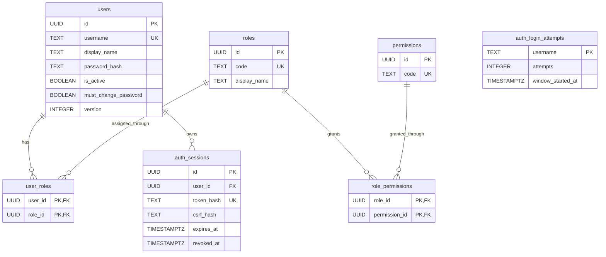
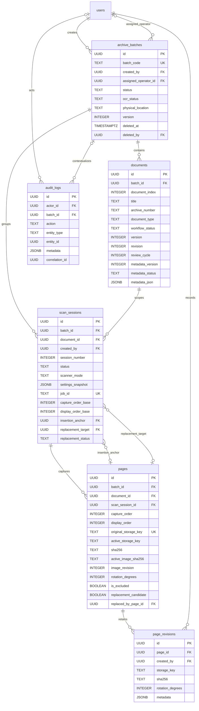
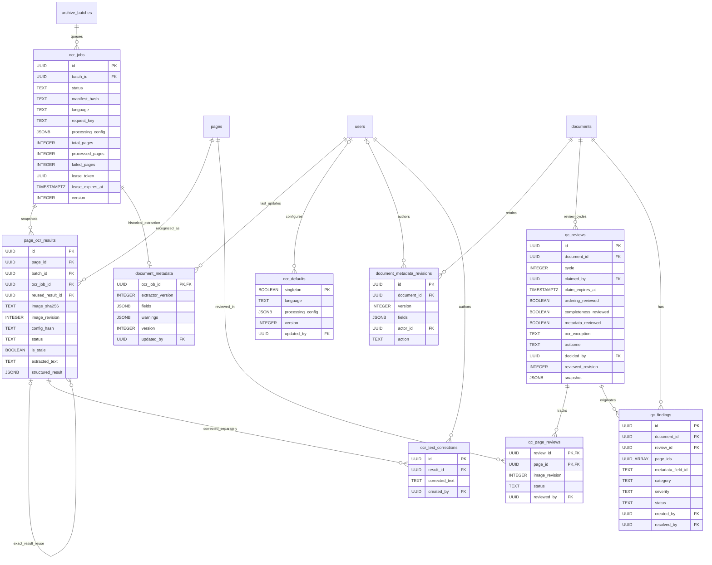

# Entity relationship diagrams

**As-built baseline: 2026-11-14, migrations 001–011.** These diagrams describe the local source schema, not a fresh inspection of a running database. Selected columns are shown; the SQL migrations remain authoritative. Approval decisions and the final archive viewer do not exist yet; their proposed model is in [APPROVAL.md](APPROVAL.md).

## 1. Accounts, roles and sessions

- Username uniqueness is on `lower(username)`, not a case-sensitive column constraint.
- `auth_login_attempts.username` is deliberately not a user FK: unknown usernames must also be throttled.
- Six roles are seeded, but L1/L2/Archive Viewer currently have permission scaffolding only. Role assignment prevents L1 + L2 and approval + Operator/QC combinations. Historical participation checks will still be needed for approval if an account changes roles later.
- Tokens and CSRF values are hashed in PostgreSQL. Raw session tokens are not stored in the frontend or these docs.

## 2. Capture, logical documents and image history

Important constraints not fully expressed by the drawing:

- The schema permits many documents per batch; the application currently creates and operates on **one logical document per batch**, across every feeder session.
- Composite FKs bind `scan_sessions(document_id,batch_id)` and `pages(scan_session_id,batch_id,document_id)` to the same document/batch. The columns are not independent cross-batch links.
- Unique pairs: `(batch_id,document_index)`, `(batch_id,session_number)` and `(batch_id,capture_order)`. A partial unique index permits only one running session per batch; the runtime also serializes the physical scanner globally.
- `pages.replaced_by_page_id` is a self-FK to the retained replacement candidate. Revision `metadata` records candidate/session provenance as JSON, not additional FK columns.
- `audit_logs.entity_id` is a polymorphic identifier, **not** a foreign key to every possible entity table. Actor and batch can be NULL for system/global events.
- Original provenance is protected by a trigger. Soft deletion excludes a batch from normal access without deleting children or files. `page_revisions` does not imply that every rotation is a new image file.

## 3. OCR, metadata and QC

- OCR job identity is unique on `(batch_id,manifest_hash,language,processing_config,request_key)`. Page results use composite job/batch and page/batch FKs, plus unique `(ocr_job_id,page_id)`.
- A successful source result has a partial uniqueness rule on page/checksum/config; reused results reference it. `image_revision` prevents stale generations being presented as current.
- `ocr_defaults` is one Boolean-keyed row, not a UUID entity. Job configuration is a saved snapshot; editing defaults does not alter existing runs.
- `documents.metadata_json.fields` is the authoritative current metadata. `document_metadata` is older per-run history. Neither field candidates nor source bounds are standalone SQL entities.
- Unique `(document_id,version)` protects metadata revisions; unique `(document_id,cycle)` protects review cycles. Metadata revisions and OCR corrections have append-only triggers.
- `UUID_ARRAY` above denotes PostgreSQL `UUID[]`. `qc_findings.page_ids` and `metadata_field_id` are application-validated references, not SQL FKs to pages or a nonexistent metadata-fields table.
- QC snapshots contain ordered public page identities/checksums/revisions, metadata, findings, page-review records and specific OCR result/correction IDs. References inside JSON are not SQL FKs. Future approval/viewer reads must resolve those saved identities rather than silently select the latest text/image.
- Reviewer/creator/resolver user FKs exist even where an extra user edge is omitted to keep the diagram readable.

## 4. Migration ledger and retention

`schema_migrations(name TEXT PRIMARY KEY, sha256 TEXT, applied_at TIMESTAMPTZ)` is maintained by `server/db.mjs`; it has no domain FK. Applied SQL files are checksummed and must never be edited in place.

Database rows describe files; images are not PostgreSQL blobs. Back up PostgreSQL, managed originals/replacements and recovery spools together. Thumbnail/preview derivatives are disposable. See [DATABASE.md](DATABASE.md) for operations and [DFD.md](DFD.md) for data movement.
